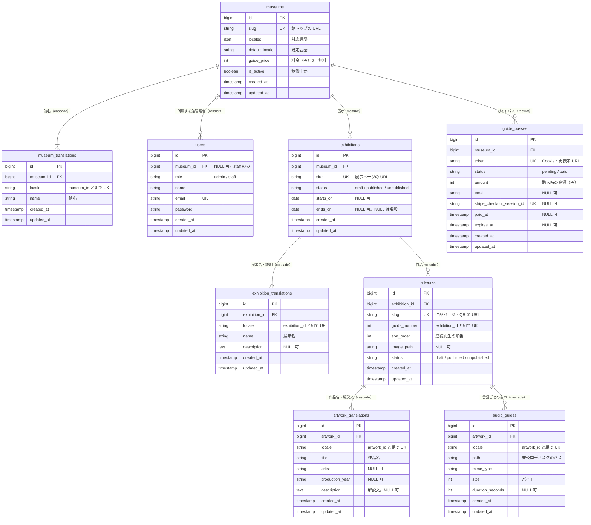

# データベース設計

> 要件は [01_requirements.md](../spec/01_requirements.md)、流れとテストは [04_flows_tests_seed.md](../spec/04_flows_tests_seed.md)、画面は [screens.md](screens.md) を参照。

## ER 図

 

## 外部キーと削除時の動き

| 外部キー | 参照先 | NULL | 削除時 | 理由 |
|-|-|:-:|:-:|-|
| `museum_translations.museum_id` | `museums.id` | | cascade | 翻訳は館の一部。館と一緒に消えてよい |
| `users.museum_id` | `museums.id` | ○ | restrict | 館管理者がいる館は消せないようにする（館は停止で運用） |
| `exhibitions.museum_id` | `museums.id` | | restrict | 展示がある館は消せない |
| `guide_passes.museum_id` | `museums.id` | | restrict | パスは売上の記録。館を消しても残す必要がある |
| `exhibition_translations.exhibition_id` | `exhibitions.id` | | cascade | 翻訳は展示の一部 |
| `artworks.exhibition_id` | `exhibitions.id` | | restrict | 作品が残っている展示は消せない。作品の画像・音声のファイルを消し忘れないよう、先に作品を削除させる |
| `artwork_translations.artwork_id` | `artworks.id` | | cascade | 翻訳は作品の一部 |
| `audio_guides.artwork_id` | `artworks.id` | | cascade | 音声は作品の一部。ファイルはアプリ側で先に削除する |

- 更新時（ON UPDATE）はすべて既定のまま（主キーは変えない）
- Laravel では `->constrained()->cascadeOnDelete()` / `->constrained()->restrictOnDelete()` で書く
- cascade は DB が直接消すため、モデルのイベントは呼ばれない。ストレージ上のファイル（画像・音声）は、作品や音声を削除するアクションの中で、レコードより先に削除する
- 既存の `sessions.user_id` は外部キー制約なし（Laravel 標準のまま）

 

## テーブル定義

### museums（館）

| カラム | 型 | 制約 | 説明 |
|-|-|-|-|
| `id` | bigint unsigned | PK、自動採番 | |
| `slug` | varchar(50) | NOT NULL、UNIQUE | 館トップの URL（`/m/{slug}`）。管理者が入力する英小文字・数字・ハイフン |
| `locales` | json | NOT NULL | 対応言語の配列（例: `["ja","en"]`）。値は `config` で定めた言語コードから選ぶ |
| `default_locale` | varchar(10) | NOT NULL | 既定言語。`locales` に含まれていること（バリデーションで保証） |
| `guide_price` | int unsigned | NOT NULL、DEFAULT 0 | 音声ガイド料金（円）。0 は無料 |
| `is_active` | boolean | NOT NULL、DEFAULT true | 稼働中か。false（停止）の館は来館者から見えない |
| `created_at` / `updated_at` | timestamp | NULL | |

- 館名は `museum_translations` に持つ

### museum_translations（館の翻訳）

| カラム | 型 | 制約 | 説明 |
|-|-|-|-|
| `id` | bigint unsigned | PK、自動採番 | |
| `museum_id` | bigint unsigned | NOT NULL、FK → `museums.id`（cascade） | |
| `locale` | varchar(10) | NOT NULL | 言語コード |
| `name` | varchar(255) | NOT NULL | 館名 |
| `created_at` / `updated_at` | timestamp | NULL | |

- UNIQUE: (`museum_id`, `locale`)

### users（ユーザー。既存テーブルに `role` と `museum_id` を追加）

| カラム | 型 | 制約 | 説明 |
|-|-|-|-|
| `id` | bigint unsigned | PK、自動採番 | |
| `museum_id` | bigint unsigned | NULL、FK → `museums.id`（restrict）、INDEX | 所属する館。`staff` は必須、`admin` は NULL |
| `role` | varchar(20) | NOT NULL、DEFAULT `staff` | `admin` / `staff`（`App\Enums\UserRole`） |
| `name` | varchar(255) | NOT NULL | 既存 |
| `email` | varchar(255) | NOT NULL、UNIQUE | 既存 |
| `email_verified_at` | timestamp | NULL | 既存 |
| `password` | varchar(255) | NOT NULL | 既存。招待時はランダムな値を入れ、招待メールから設定し直す |
| `two_factor_secret` / `two_factor_recovery_codes` | text | NULL | 既存（Fortify） |
| `two_factor_confirmed_at` | timestamp | NULL | 既存（Fortify） |
| `remember_token` | varchar(100) | NULL | 既存 |
| `created_at` / `updated_at` | timestamp | NULL | |

- `role` と `museum_id` の組み合わせ（staff なら必須、admin なら NULL）はバリデーションで保証する。DB の制約にはしない

### exhibitions（展示）

| カラム | 型 | 制約 | 説明 |
|-|-|-|-|
| `id` | bigint unsigned | PK、自動採番 | |
| `museum_id` | bigint unsigned | NOT NULL、FK → `museums.id`（restrict） | |
| `slug` | char(12) | NOT NULL、UNIQUE | 展示ページの URL（`/e/{slug}`）。作成時にランダムな英小文字・数字 12 文字で生成し、変えない |
| `status` | varchar(20) | NOT NULL、DEFAULT `draft` | `draft` / `published` / `unpublished`（`App\Enums\PublishStatus`） |
| `starts_on` | date | NULL | 開始日。NULL なら開始日の制限なし |
| `ends_on` | date | NULL | 終了日。NULL なら終了日なし（常設展） |
| `created_at` / `updated_at` | timestamp | NULL | |

- INDEX: (`museum_id`, `status`)
- 来館者に見える条件: `status = published` かつ 今日が `starts_on`〜`ends_on` の範囲内（NULL は制限なし）

### exhibition_translations（展示の翻訳）

| カラム | 型 | 制約 | 説明 |
|-|-|-|-|
| `id` | bigint unsigned | PK、自動採番 | |
| `exhibition_id` | bigint unsigned | NOT NULL、FK → `exhibitions.id`（cascade） | |
| `locale` | varchar(10) | NOT NULL | 言語コード |
| `name` | varchar(255) | NOT NULL | 展示名 |
| `description` | text | NULL | 展示の説明 |
| `created_at` / `updated_at` | timestamp | NULL | |

- UNIQUE: (`exhibition_id`, `locale`)

### artworks（作品）

| カラム | 型 | 制約 | 説明 |
|-|-|-|-|
| `id` | bigint unsigned | PK、自動採番 | |
| `exhibition_id` | bigint unsigned | NOT NULL、FK → `exhibitions.id`（restrict） | |
| `slug` | char(12) | NOT NULL、UNIQUE | 作品ページの URL（`/a/{slug}`）と QR コードに使う。作成時にランダムに生成し、変えない |
| `guide_number` | int unsigned | NOT NULL | ガイド番号 |
| `sort_order` | int unsigned | NOT NULL、DEFAULT 0 | 並び順（連続再生の順番）。同じ値のときはガイド番号順 |
| `image_path` | varchar(255) | NULL | `public` ディスク上の画像のパス（`images/{museum_id}/...`） |
| `status` | varchar(20) | NOT NULL、DEFAULT `draft` | `draft` / `published` / `unpublished` |
| `created_at` / `updated_at` | timestamp | NULL | |

- UNIQUE: (`exhibition_id`, `guide_number`)
- INDEX: (`exhibition_id`, `sort_order`)
- `museum_id` は持たず、`exhibition` を通して館を決める。館管理者の絞り込みは `whereHas('exhibition', ...)` か、館で絞るスコープで行う

### artwork_translations（作品の翻訳）

| カラム | 型 | 制約 | 説明 |
|-|-|-|-|
| `id` | bigint unsigned | PK、自動採番 | |
| `artwork_id` | bigint unsigned | NOT NULL、FK → `artworks.id`（cascade） | |
| `locale` | varchar(10) | NOT NULL | 言語コード |
| `title` | varchar(255) | NOT NULL | 作品名 |
| `artist` | varchar(255) | NULL | 作者名（例: 葛飾北斎 / Katsushika Hokusai） |
| `production_year` | varchar(50) | NULL | 制作年（例: 1831年頃 / c. 1831、江戸時代） |
| `description` | text | NULL | 解説文。音声の読み上げ原稿も兼ねる |
| `created_at` / `updated_at` | timestamp | NULL | |

- UNIQUE: (`artwork_id`, `locale`)
- 作者名と制作年は言語で書き方が変わるため翻訳側に持つ。制作年は「〜年頃」「江戸時代」などがあるので文字列にする

### audio_guides（音声ガイド）

| カラム | 型 | 制約 | 説明 |
|-|-|-|-|
| `id` | bigint unsigned | PK、自動採番 | |
| `artwork_id` | bigint unsigned | NOT NULL、FK → `artworks.id`（cascade） | |
| `locale` | varchar(10) | NOT NULL | 言語コード |
| `path` | varchar(255) | NOT NULL | `local`（非公開）ディスク上のパス（`audio/{museum_id}/{ランダム}.mp3`） |
| `mime_type` | varchar(50) | NOT NULL | `audio/mpeg` / `audio/mp4` |
| `size` | int unsigned | NOT NULL | ファイルサイズ（バイト）。20MB まで |
| `duration_seconds` | int unsigned | NULL | 再生時間（秒）。拡張 E6 で設定する |
| `created_at` / `updated_at` | timestamp | NULL | |

- UNIQUE: (`artwork_id`, `locale`)（1作品につき1言語1件）

### guide_passes（ガイドパス）

| カラム | 型 | 制約 | 説明 |
|-|-|-|-|
| `id` | bigint unsigned | PK、自動採番 | |
| `museum_id` | bigint unsigned | NOT NULL、FK → `museums.id`（restrict） | |
| `token` | char(40) | NOT NULL、UNIQUE | ランダムな 40 文字。Cookie と再表示用 URL（`/passes/{token}`）に使う |
| `status` | varchar(20) | NOT NULL、DEFAULT `pending` | `pending` / `paid`（`App\Enums\GuidePassStatus`） |
| `amount` | int unsigned | NOT NULL | 注文時点の単価（円）。作成時に `museums.guide_price` をコピーし、後から料金が変わっても書き換えない。数量は常に 1 なので合計金額も兼ねる |
| `email` | varchar(255) | NULL | 購入者のメールアドレス。支払い確定時に Stripe の `customer_details.email` から保存 |
| `stripe_checkout_session_id` | varchar(255) | NULL、UNIQUE | Checkout Session の ID。Session を作った直後に保存し、完了ページと Webhook で支払いを確認するときに使う。Session を作る前の一瞬だけ NULL |
| `paid_at` | timestamp | NULL | 支払い確定日時 |
| `expires_at` | timestamp | NULL | 有効期限。`paid_at` の 24 時間後 |
| `created_at` / `updated_at` | timestamp | NULL | |

- INDEX: (`museum_id`, `status`)（売上の集計用）
- このアプリの「注文」はガイドパス1件にあたる。1回の購入で買うのは「館のガイドパス1枚」だけなので、注文（orders）と明細（order_items）には分けず、`guide_passes` が注文と明細を兼ねる。注文時点の単価は `amount` に保存する
- 拡張で複数の料金区分（一般・学生など）や複数枚の同時購入を入れるときは、`guide_pass_items`（`guide_pass_id`、区分、`unit_price`、`quantity`）を追加して明細に分ける
- 有効なパスの条件: `status = paid` かつ `expires_at > 現在`
- `paid` への更新は `where('status', 'pending')` をつけた条件付き更新にする（[04](../spec/04_flows_tests_seed.md) の Stripe の実装方針）

 

## Enum

| Enum | 値 | 使う場所 |
|-|-|-|
| `App\Enums\UserRole` | `Admin` = `admin`、`Staff` = `staff` | `users.role` |
| `App\Enums\PublishStatus` | `Draft` = `draft`、`Published` = `published`、`Unpublished` = `unpublished` | `exhibitions.status`、`artworks.status` |
| `App\Enums\GuidePassStatus` | `Pending` = `pending`、`Paid` = `paid` | `guide_passes.status` |

- DB には文字列で保存し、モデルの `casts()` で Enum にキャストする。画面の表示名（下書き / 公開 / 非公開 など）は Enum の `label()` メソッドで返す

 

## 翻訳の取り出し方

- 各モデルに `translations()`（hasMany）と、表示言語の翻訳を返すメソッド（例: `translation(string $locale)`）を持たせる。指定言語が無ければ館の既定言語の翻訳を返す
- 一覧画面では `with('translations')` で翻訳をまとめて読み込み、N+1 を避ける
- 表示言語は「セッションの選択言語 → 館の既定言語」の順で決める（[04](../spec/04_flows_tests_seed.md) の音声ガイドの実装方針）

 

## マイグレーションの順番

| # | マイグレーション | 内容 |
|:-:|-|-|
| 1 | `create_museums_table` | museums |
| 2 | `create_museum_translations_table` | museum_translations |
| 3 | `add_role_and_museum_id_to_users_table` | users に `role`、`museum_id` を追加 |
| 4 | `create_exhibitions_table` | exhibitions |
| 5 | `create_exhibition_translations_table` | exhibition_translations |
| 6 | `create_artworks_table` | artworks |
| 7 | `create_artwork_translations_table` | artwork_translations |
| 8 | `create_audio_guides_table` | audio_guides |
| 9 | `create_guide_passes_table` | guide_passes |
