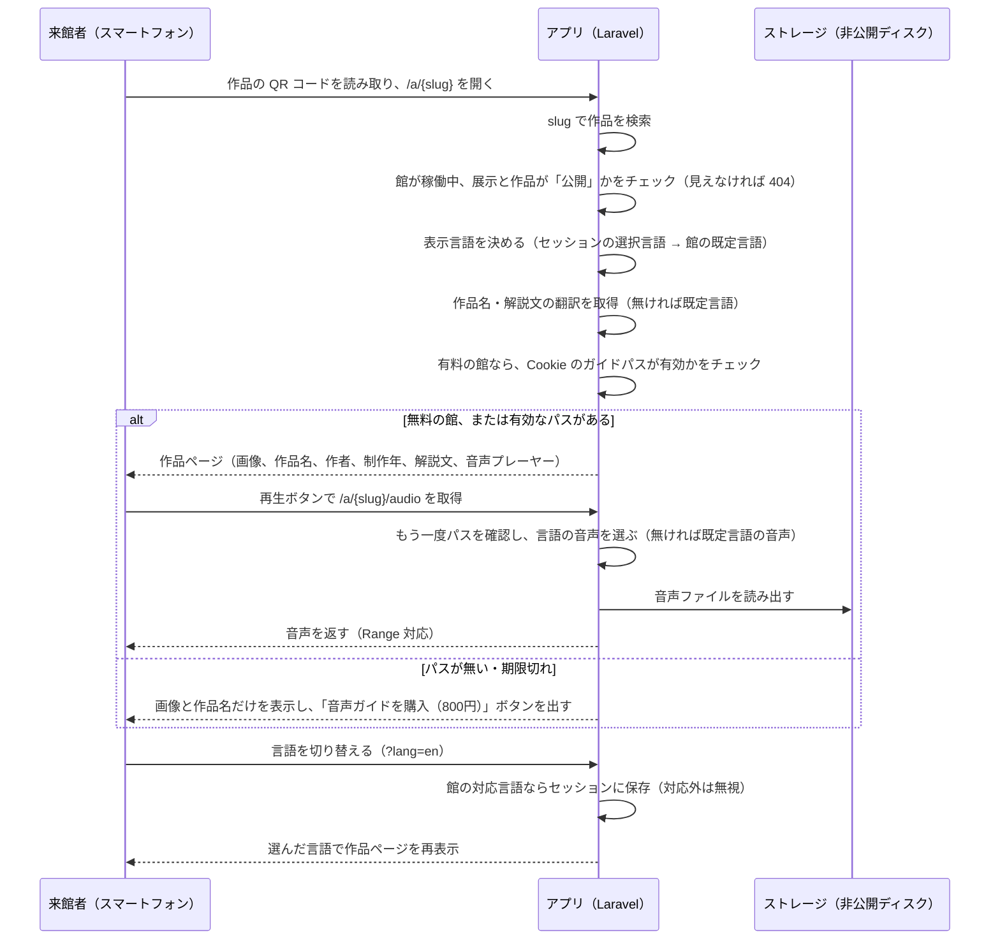
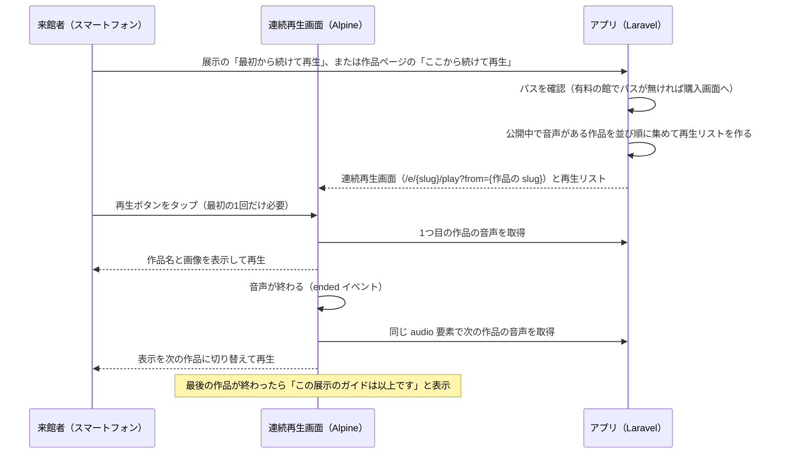
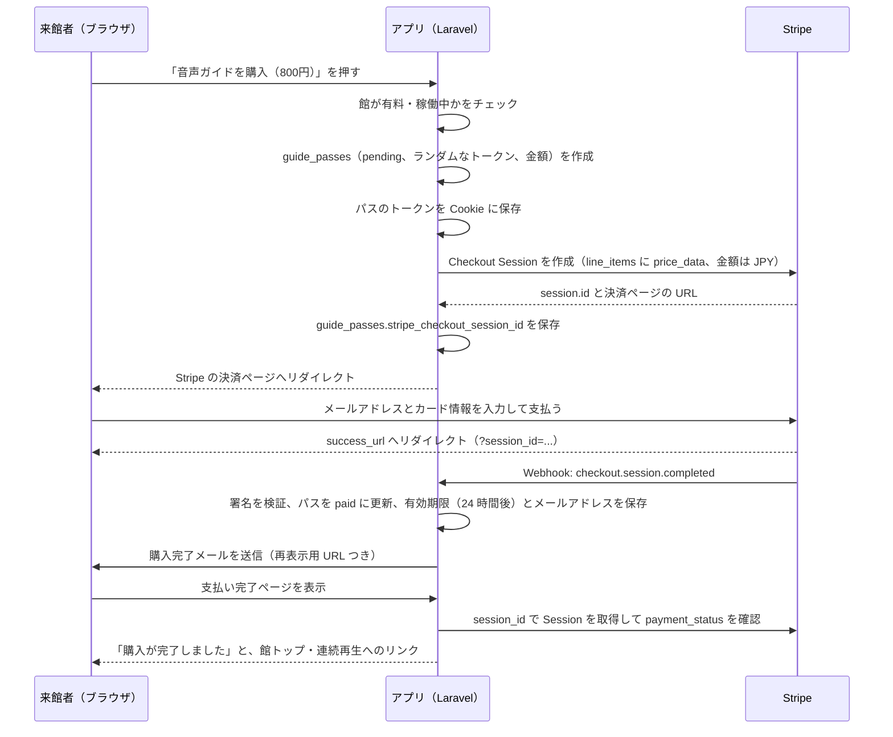
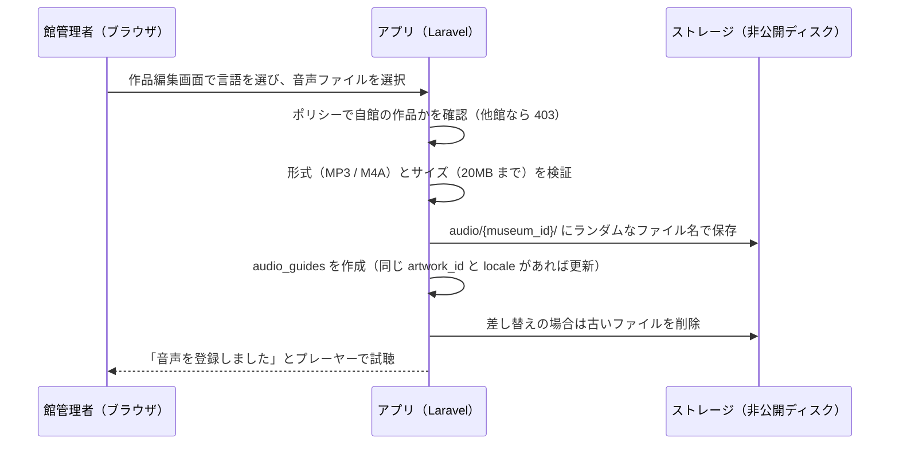

# 仕様書 4: 音声ガイド・決済・メールの流れ、テスト、初期データ

> 平日課題（08〜11 章）で使います。

## 来館者が音声ガイドを聴く流れ

ガイド番号から開く場合は、館トップ（`/m/{museum:slug}`）で展示を選び、番号を入力する。`exhibition_id` と `guide_number` で作品を探し、見つかれば作品ページ（`/a/{slug}`）へリダイレクトする。見つからなければ「この番号の作品はありません」と表示する。

 

## 連続再生の流れ

 

## ガイドパスの購入の流れ

 

## 館管理者が音声を登録する流れ

 

## 音声ガイドの実装方針

- 作品ページの URL は `/a/{slug}`、展示は `/e/{slug}`。slug は作成時にランダムな英小文字と数字 12 文字で生成し、後から変えない（QR コードを刷り直さなくて済むように）
- URL に言語を含めない。言語は `?lang=xx` で選び、セッションに保存する。館の対応言語に無い値は無視する
- 翻訳が無い項目は、項目ごとに館の既定言語で表示する。音声も同じで、選択言語の音声が無いときは既定言語の音声を再生し、「この言語の音声はありません」と表示する
- 来館者に見せる条件は「館が稼働中」「展示が公開」「作品が公開」のすべてを満たすこと。満たさないものは 404 にする（存在を知らせない）
- 館管理者向けのクエリとポリシーは、必ず `museum_id` で自館に絞る。ルートモデルバインディングで他館の ID を指定されても 403 にする
- 画像は `public` ディスクの `images/{museum_id}/` に保存する。音声は非公開の `local` ディスクの `audio/{museum_id}/` に保存し、`/a/{slug}/audio` のルートでパスを確認してから `response()->file()` で返す（シーク用の Range リクエストに対応する）。ファイル名はランダムにし、元のファイル名は使わない
- QR コードはライブラリで SVG を生成する。生成処理はサービスクラス（例: `QrCodeService`）に閉じ込める。中身は作品ページの絶対 URL（`APP_URL` から作る）
- 作品や音声を削除したら、ストレージ上のファイルも削除する

### 連続再生

- 順番は `artworks.sort_order`（館管理者が設定）。同じ値のときはガイド番号順
- 再生リストに入れるのは、公開中で、選択言語か既定言語の音声がある作品だけ。音声の無い作品は飛ばす
- 画面は Livewire の単一ファイルコンポーネントで作り、再生の制御は Alpine で行う。再生リスト（作品名、画像 URL、音声 URL）はページに JSON で埋め込む
- `<audio>` 要素は1つだけ使い、`ended` イベントで `src` を次の作品に差し替えて `play()` する。ブラウザの自動再生の制限があるため、最初の1回は来館者のタップで再生を始める。ページを開いただけでは再生しない
- 操作は 再生 / 一時停止、前の作品、次の作品、作品の一覧から選んで移動。作品の情報（画像、作品名、解説文）は再生中の作品に合わせて切り替える
- 画面ロック中や別アプリ表示中の動作は端末によって違うため、コアでは画面を開いたままの利用を前提とする（拡張 E5 で対応）

 

## Stripe の実装方針

- `stripe/stripe-php` を直接使う。Cashier は使わない（来館者はユーザーとして保存せず、1回払いだけなので、Cashier の顧客・サブスクリプションの概念が不要）
- 料金は館ごとに `museums.guide_price`（円の整数）で持つ。0 なら無料で、購入ボタンもパスの確認も出さない。パスには購入時の金額を `amount` として保存し、後から料金を変えても影響しない
- パスは館単位で、その館の全ての展示で使える。有効期限は支払いから 24 時間（`expires_at`）
- パスのトークンはランダムな 40 文字。暗号化された Cookie（館ごとに1つ）に保存して判定する
- Checkout Session は `mode = payment`、`line_items` に `price_data`（`currency = jpy`、`unit_amount = 料金`、`product_data.name = 館名 音声ガイド`）を指定する。Stripe 側に商品を事前登録しない
- メールアドレスは Stripe Checkout の入力欄で集め、Webhook や完了ページで `customer_details.email` から保存する。アプリ側に入力欄は作らない
- `metadata.guide_pass_id` にパス ID を入れておき、Webhook でパスを特定する
- `success_url` は `/passes/complete?session_id={CHECKOUT_SESSION_ID}`、`cancel_url` は `/m/{museum:slug}`
- Webhook は `POST /stripe/webhook`。CSRF の除外対象にし、`Webhook::constructEvent()` で署名を検証する
- 扱うイベントはコアでは `checkout.session.completed` のみ。拡張 E15 で `charge.refunded` を追加
- Webhook と完了ページのどちらが先に来ても壊れないように、`paid` への更新は「`pending` のときだけ更新する」条件付き更新にする。購入完了メールは、その更新に成功した側だけが送る（二重に送らない）
- 再表示用 URL `/passes/{token}` を開くと、そのパスを Cookie に保存して館トップへリダイレクトする。Cookie を消した場合や別の端末でも聴き直せる
- 購入ボタン（パスの作成）はゲストが押せるため、レート制限（`throttle`）をかけて `pending` のパスを大量に作られないようにする
- Checkout Session の作成と取得はサービスクラス（例: `CheckoutService`）に閉じ込める

### 環境変数

| 変数 | 内容 | 開発 | 本番 |
|-|-|-|-|
| `APP_URL` | QR コードに埋め込む URL のもと | `http://localhost`（スマホで確認するときは PC の LAN の IP） | `https://本番のドメイン` |
| `STRIPE_KEY` | 公開可能キー（`pk_test_...` / `pk_live_...`） | テスト | 本番 |
| `STRIPE_SECRET` | シークレットキー（`sk_test_...` / `sk_live_...`） | テスト | 本番 |
| `STRIPE_WEBHOOK_SECRET` | Webhook の署名シークレット（`whsec_...`） | Stripe CLI が発行 | ダッシュボードで登録して取得 |
| `MAIL_MAILER` | メールの送信方法 | `smtp`（Mailpit） | `resend` など |

### 開発環境での確認

- `sail artisan storage:link` で `public/storage` を作ってから、画像を確認する（音声は非公開ディスクなのでリンクは不要）
- スマートフォンから `localhost` には届かないため、QR コードの読み取りと連続再生は、同じ Wi-Fi で PC の IP を `APP_URL` に入れて確認する。難しい場合は、PC のブラウザで URL を開くだけでもよい。実機での確認は Day5 の本番公開後に行う
- Webhook は Stripe CLI の `stripe listen --forward-to localhost/stripe/webhook` でローカルに転送する
- CLI を入れない場合は、完了ページ側の確認（`payment_status` の取得）だけでも動作する。Webhook は Day5 の本番公開後に確認する

 

## メール

| メール | 送信タイミング | 宛先 | 内容 |
|-|-|-|-|
| 購入完了 | ガイドパスが `paid` になったとき | 購入者（Stripe Checkout で入力したアドレス） | 館名、金額、有効期限、再表示用 URL、館トップへの URL |
| 館管理者の招待 | プラットフォーム管理者が館管理者アカウントを発行したとき | 発行した館管理者 | 館名、ログイン用メールアドレス、パスワード設定ページへの URL（有効期限つき） |
| パスワードリセット | ログイン画面で再設定を申し込んだとき | 申し込んだユーザー | パスワード再設定ページへの URL（Fortify 標準） |

- 購入完了と招待は、それぞれ Mailable（または Notification）1つ。Markdown メールテンプレート。招待のパスワード設定はパスワードリセットの仕組みを使い回す
- 開発は Mailpit（`http://localhost:8025`）で確認する
- 本番のメール API は1つに固定する（Resend などの無料枠）。`.env` の `MAIL_MAILER` と API キーだけを変える
- キューは使わない（拡張 E6 で導入）
- 来館者のメールアドレスは購入完了メールにだけ使い、それ以外のメールは送らない

 

## Pest テスト（コア C25・C26）

| # | テスト | 確認すること |
|:-:|-|-|
| T1 | 館トップの展示一覧 | 公開中の展示は表示され、下書き・非公開・期間外の展示は表示されない |
| T2 | 作品ページ（無料の館） | slug で作品名・解説文・音声プレーヤーが表示される。ログインもパスも不要 |
| T3 | 作品ページ（非公開） | 作品か展示が下書き・非公開、または館が停止中なら 404 |
| T4 | ガイド番号 | 展示と番号で正しい作品ページへリダイレクトされる。別の展示の同じ番号の作品は開かない。無い番号はエラー表示 |
| T5 | ガイド番号の重複 | 同じ展示で同じ番号は登録できない。別の展示なら登録できる |
| T6 | 展示・作品の作成 | 館管理者は自館に作成できる。未ログインはログイン画面へリダイレクト |
| T7 | 館の分離 | 館管理者は他館の展示・作品・料金・売上を閲覧・更新できない（403） |
| T8 | 音声のアップロード | 自館の作品に登録でき、ファイルが保存される。同じ言語は差し替えになり古いファイルが消える（`Storage::fake()`） |
| T9 | 音声の検証 | MP3 / M4A 以外や 20MB 超はエラーになり、保存されない |
| T10 | 連続再生の再生リスト | 公開中で音声がある作品だけが並び順で入る。下書きの作品と音声の無い作品は入らない。`from` を指定するとその作品から始まる |
| T11 | 言語の切り替え | 対応言語は翻訳で表示され、翻訳が無い項目は既定言語になる。対応外の言語は無視される |
| T12 | 有料の館（パスなし） | 画像と作品名は表示され、解説文は表示されず購入ボタンが出る。音声のルートは 403 |
| T13 | 購入（正常） | パスが `pending` で作られ、金額が館の料金と同じで、Cookie にトークンが入る。Stripe はモックする |
| T14 | 購入（無料・停止中の館） | パスは作られず、Stripe も呼ばれない |
| T15 | Webhook（正常） | 正しい署名の `checkout.session.completed` でパスが `paid` になり、有効期限とメールアドレスが保存され、メールが送られる（`Mail::fake()`） |
| T16 | Webhook（不正な署名） | 400 を返し、パスは変わらない |
| T17 | Webhook（二重送信） | 同じイベントが2回来ても、完了ページと Webhook の両方で確定しても、メールは1通だけ |
| T18 | パスの有効期限と再表示 | 有効なパスで音声を取得できる。24 時間を過ぎると 403。再表示用 URL を開くと Cookie にパスが入る。他館のパスでは聴けない |
| T19 | 館の登録と停止 | 管理者は館を登録・停止できる。館管理者は 403 |
| T20 | 館管理者の発行 | 管理者が発行するとユーザーが作られ、招待メールが送られる（`Mail::fake()`）。館管理者は発行できない |
| T21 | slug | 作品・展示の作成時に一意な slug が生成され、更新しても変わらない |

外部サービスのモック方針: Checkout Session の作成・取得はサービスクラス（例: `CheckoutService`）、QR コードの生成は `QrCodeService` に閉じ込め、テストではそのクラスをモックする。拡張 E1・E2 の音声合成や翻訳 API も同じ方針にする。

 

## 初期データ（シーダー）

| データ | 件数 | 内容 |
|-|:-:|-|
| プラットフォーム管理者 | 1 | `admin@example.com` / `password` |
| 館管理者 | 3 | `staff1@example.com`、`staff2@example.com`（館1）、`staff3@example.com`（館2） / `password` |
| 館 | 3 | 稼働中 2（館1: 有料 800 円、日本語・英語、既定は日本語 / 館2: 無料、日本語のみ）、停止中 1。題名の例: 岩手山麓美術館、みちのく民俗資料館 |
| 展示 | 各館 2〜4 | 公開の常設展、公開の企画展（期間内）、下書き 1、期間が終わった企画展 1 を混ぜる |
| 作品 | 各展示 3〜6 | 並び順とガイド番号は展示ごとに 1 から。別の展示で同じ番号を使う例を入れる。下書きの作品も 1 件混ぜる |
| 解説文（翻訳） | 作品ごと | 日本語は全件。館1 の英語は一部だけ（翻訳なし → 既定言語になる例を作る） |
| 音声ガイド | 数件 | 日本語の音声がある作品、英語もある作品、音声が無い作品を混ぜる（連続再生で飛ばされる例を作る） |
| ガイドパス | 数件 | 館1 の有効な `paid`、期限切れの `paid`、15 分以上前の `pending` を混ぜる |

- パスワードは全員 `password`。本番にはシーダーのプラットフォーム管理者以外を投入しない
- 画像はシーダー用に数枚を `database/seeders/images/`、音声は数秒の短い MP3 を `database/seeders/audio/` に置き、シーダーで `public` ディスク（画像）と `local` ディスク（音声）へコピーする
- 有効なパスの再表示用 URL をシーダーの実行結果に表示し、開発中にすぐ有料の館を試せるようにする

 

## Day ごとの到達点（参考実装のタグ）

| タグ | 到達点 |
|-|-|
| `day4-core` | 講師版: C1〜C25 に音声アップロード、連続再生、ガイドパスの購入を加えたものが動き、テストが全て通る（Stripe はテストモード） |
| `day5-deploy` | 本番用の設定（`.env.example` の整理、`APP_ENV=production` での動作確認）、Webhook の本番確認、実機での QR 読み取りと連続再生の確認 |
| `day6-actions` | `.github/workflows/` に CI（テスト）と CD（SSH デプロイ）を追加 |
